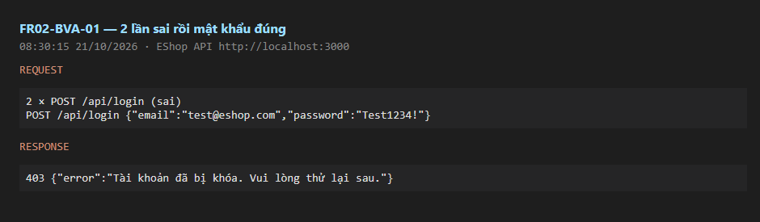

# BUG-FR02-01

> Bản nháp để tạo issue trên repo nhóm (template **Bug report**). Copy từng ô bên dưới vào ô tương ứng của form.

**Tiêu đề issue:** `[23120017][FR-02][Web] Sai 2 lần thì lần thứ 3 nhập đúng mật khẩu vẫn bị khóa (ngưỡng khóa lệch 1)`

**Labels:** `bug`, `severity: high`, `platform: web`, `technique: BVA`, `pool: A` · **Assignee:** chính mình

| Ô trong form | Nội dung |
|---|---|
| MSSV người báo | 23120017 |
| Feature (mã FR) | FR-02 – Đăng nhập & khóa tài khoản |
| Nền tảng | Web |
| Test case phát hiện lỗi | FR02-BVA-01, FR02-EP-11 |
| Mức độ (Severity) | High |

### Điều kiện tiên quyết
Backend vừa khởi động lại (DB seed mới); tài khoản test@eshop.com chưa đăng nhập sai lần nào

### Các bước tái hiện
1. Gửi 2 lần POST /api/login với {"email":"test@eshop.com","password":"Wrong123!"} (cả 2 trả 401)
2. Ngay sau đó gửi POST /api/login với mật khẩu đúng Test1234!

### Dữ liệu test
test@eshop.com / Wrong123! (×2), rồi Test1234!

### Kết quả mong đợi (theo đặc tả)
FR-02: "Nếu đăng nhập sai từ **3 lần trở lên** liên tiếp, tài khoản bị tạm khóa". Mới sai 2 lần nên lần thứ 3 đúng mật khẩu phải đăng nhập thành công (200 + token).

### Kết quả thực tế
403 {"error":"Tài khoản đã bị khóa. Vui lòng thử lại sau."}. Tài khoản bị khóa ngay ở lần thử thứ 3 dù mật khẩu đúng. Lặp lại ở FR02-EP-11: 2 lần sai → đúng cũng bị 403.

### Ảnh chụp
Kéo thả các file sau vào ô "Ảnh chụp":
- `evidence/FR02/FR02-BVA-01.png`

  

### Môi trường
Windows 11 Home; Microsoft Edge 155.0.4283.62 (điều khiển bằng Playwright 1.48.2) và curl/fetch (Node v22.23.2); EShop commit 85af3ba

### Ghi chú
- Lý do chọn severity: Người dùng gõ nhầm 2 lần thì không thể đăng nhập dù nhập đúng, và bị khóa ~3 phút (xem BUG-FR02-02); không có cách nào tránh → câu 2 của cây quyết định.
- Tái hiện: 100 % (chạy lại bằng `scripts/fr02.mjs`).
