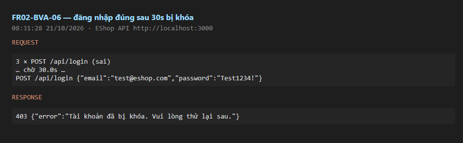
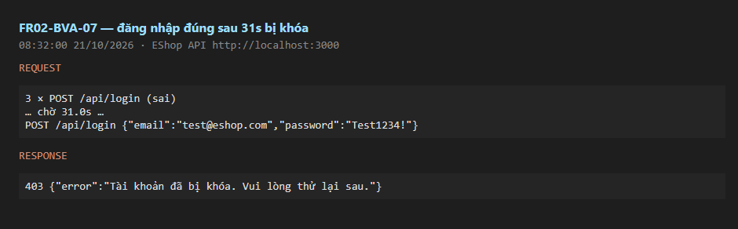

# BUG-FR02-02

> Bản nháp để tạo issue trên repo nhóm (template **Bug report**). Copy từng ô bên dưới vào ô tương ứng của form.

**Tiêu đề issue:** `[23120017][FR-02][Web] Tài khoản bị khóa khoảng 180 giây thay vì 30 giây`

**Labels:** `bug`, `severity: medium`, `platform: web`, `technique: BVA`, `pool: A` · **Assignee:** chính mình

| Ô trong form | Nội dung |
|---|---|
| MSSV người báo | 23120017 |
| Feature (mã FR) | FR-02 – Đăng nhập & khóa tài khoản |
| Nền tảng | Web |
| Test case phát hiện lỗi | FR02-BVA-06, FR02-BVA-07, FR02-BVA-08a, FR02-BVA-08b |
| Mức độ (Severity) | Medium |

### Điều kiện tiên quyết
Backend vừa khởi động lại; test@eshop.com vừa đăng nhập sai 3 lần liên tiếp (bị khóa)

### Các bước tái hiện
1. Gửi 3 lần POST /api/login với mật khẩu sai
2. Chờ đúng 30 s (hoặc 31 s) kể từ lần sai thứ 3, không gửi request nào trong lúc chờ
3. Gửi POST /api/login với mật khẩu đúng Test1234!

### Dữ liệu test
t = 30 s, 31 s; khám phá thêm t = 175 s, 185 s (mỗi giá trị một lần khóa mới, chỉ thử 1 lần)

### Kết quả mong đợi (theo đặc tả)
FR-02: "tài khoản bị tạm khóa **30 giây** (môi trường demo)". Từ t ≥ 30 s phải đăng nhập được.

### Kết quả thực tế
t = 30 s → 403, t = 31 s → 403 (vẫn khóa). Đo khám phá: t = 175 s → 403, t = 185 s → 200. Thời gian khóa thực tế ≈ 180 s, gấp 6 lần đặc tả.

### Ảnh chụp
Kéo thả các file sau vào ô "Ảnh chụp":
- `evidence/FR02/FR02-BVA-06.png`

  
- `evidence/FR02/FR02-BVA-07.png`

  

### Môi trường
Windows 11 Home; Microsoft Edge 155.0.4283.62 (điều khiển bằng Playwright 1.48.2) và curl/fetch (Node v22.23.2); EShop commit 85af3ba

### Ghi chú
- Lý do chọn severity: Sai quy tắc nghiệp vụ; có cách đi vòng (đợi lâu hơn) → câu 3.
- Tái hiện: 100 % (chạy lại bằng `scripts/fr02.mjs`).
