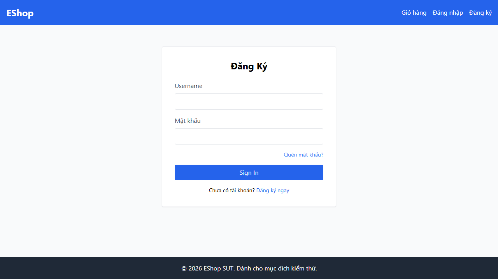

# BUG-FR02-03

> Bản nháp để tạo issue trên repo nhóm (template **Bug report**). Copy từng ô bên dưới vào ô tương ứng của form.

**Tiêu đề issue:** `[23120017][FR-02][Web] Ô Mật khẩu ở trang Đăng nhập là type="text", mật khẩu hiện rõ khi gõ`

**Labels:** `bug`, `severity: high`, `platform: web`, `technique: EP`, `pool: A` · **Assignee:** chính mình

| Ô trong form | Nội dung |
|---|---|
| MSSV người báo | 23120017 |
| Feature (mã FR) | FR-02 – Đăng nhập & khóa tài khoản |
| Nền tảng | Web |
| Test case phát hiện lỗi | FR02-EP-09 |
| Mức độ (Severity) | High |

### Điều kiện tiên quyết
Mở http://localhost:5173/login

### Các bước tái hiện
1. Gõ mật khẩu vào ô "Mật khẩu"
2. Mở DevTools → Elements, xem thuộc tính type của ô

### Dữ liệu test
Test1234!

### Kết quả mong đợi (theo đặc tả)
FR-22: "Trường Mật khẩu phải dùng `type=\"password\"` (không hiển thị rõ)".

### Kết quả thực tế
Ô mật khẩu là <input type="text">, ký tự hiện rõ trên màn hình.

### Ảnh chụp
Kéo thả các file sau vào ô "Ảnh chụp":
- `evidence/FR02/FR02-EP-09.png`

  

### Môi trường
Windows 11 Home; Microsoft Edge 155.0.4283.62 (điều khiển bằng Playwright 1.48.2) và curl/fetch (Node v22.23.2); EShop commit 85af3ba

### Ghi chú
- Lý do chọn severity: Lộ mật khẩu cho người nhìn màn hình / quay màn hình; người dùng không thể tự tránh. Không chọn critical vì không lộ qua mạng hay DB.
- Tái hiện: 100 % (chạy lại bằng `scripts/fr02.mjs`).
