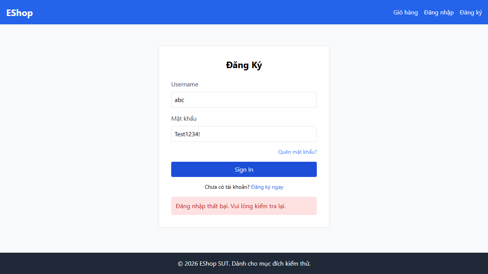

# BUG-FR02-04

> Bản nháp để tạo issue trên repo nhóm (template **Bug report**). Copy từng ô bên dưới vào ô tương ứng của form.

**Tiêu đề issue:** `[23120017][FR-02][Web] Ô Email ở trang Đăng nhập là type="text", không validate định dạng email (HTML5)`

**Labels:** `bug`, `severity: medium`, `platform: web`, `technique: EP`, `pool: A` · **Assignee:** chính mình

| Ô trong form | Nội dung |
|---|---|
| MSSV người báo | 23120017 |
| Feature (mã FR) | FR-02 – Đăng nhập & khóa tài khoản |
| Nền tảng | Web |
| Test case phát hiện lỗi | FR02-EP-04, FR02-EP-09 |
| Mức độ (Severity) | Medium |

### Điều kiện tiên quyết
Mở http://localhost:5173/login, DevTools → Network

### Các bước tái hiện
1. Nhập "abc" vào ô email, "Test1234!" vào ô mật khẩu
2. Bấm nút đăng nhập

### Dữ liệu test
Email: abc

### Kết quả mong đợi (theo đặc tả)
FR-02: "Trường email phải dùng `type=\"email\"` (có validate HTML5 format)". Trình duyệt phải chặn submit.

### Kết quả thực tế
Ô email là <input type="text"> (nhãn "Username"); form vẫn gửi POST /api/login với email "abc".

### Ảnh chụp
Kéo thả các file sau vào ô "Ảnh chụp":
- `evidence/FR02/FR02-EP-04.png`

  

### Môi trường
Windows 11 Home; Microsoft Edge 155.0.4283.62 (điều khiển bằng Playwright 1.48.2) và curl/fetch (Node v22.23.2); EShop commit 85af3ba

### Ghi chú
- Lý do chọn severity: Sai validation; có cách đi vòng (backend vẫn từ chối) → câu 3.
- Tái hiện: 100 % (chạy lại bằng `scripts/fr02.mjs`).
