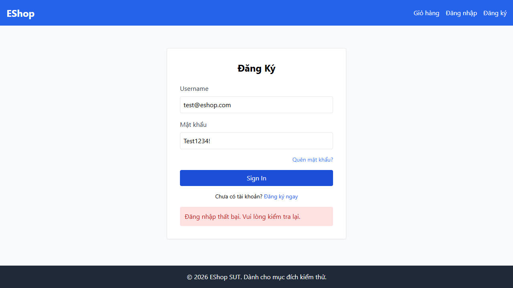

# BUG-FR02-05

> Bản nháp để tạo issue trên repo nhóm (template **Bug report**). Copy từng ô bên dưới vào ô tương ứng của form.

**Tiêu đề issue:** `[23120017][FR-02][Web] Khi tài khoản bị khóa, trang Đăng nhập chỉ báo chung "Đăng nhập thất bại" và thông báo nằm dưới nút`

**Labels:** `bug`, `severity: low`, `platform: web`, `technique: EP`, `pool: A` · **Assignee:** chính mình

| Ô trong form | Nội dung |
|---|---|
| MSSV người báo | 23120017 |
| Feature (mã FR) | FR-02 – Đăng nhập & khóa tài khoản |
| Nền tảng | Web |
| Test case phát hiện lỗi | FR02-EP-10 |
| Mức độ (Severity) | Low |

### Điều kiện tiên quyết
test@eshop.com đã đăng nhập sai 3 lần (API trả 403 "Tài khoản đã bị khóa…")

### Các bước tái hiện
1. Mở /login, nhập test@eshop.com / Test1234!
2. Bấm nút đăng nhập
3. Quan sát thông báo và vị trí

### Dữ liệu test
test@eshop.com / Test1234!

### Kết quả mong đợi (theo đặc tả)
FR-02: "Hệ thống trả về thông báo lỗi phù hợp". Người dùng cần biết tài khoản đang tạm khóa. FR-22: "Thông báo lỗi phải xuất hiện **trên** nút submit".

### Kết quả thực tế
UI luôn hiện "Đăng nhập thất bại. Vui lòng kiểm tra lại." (bỏ qua thông báo khóa của API) và thông báo nằm **dưới** nút submit.

### Ảnh chụp
Kéo thả các file sau vào ô "Ảnh chụp":
- `evidence/FR02/FR02-EP-10.png`

  

### Môi trường
Windows 11 Home; Microsoft Edge 155.0.4283.62 (điều khiển bằng Playwright 1.48.2) và curl/fetch (Node v22.23.2); EShop commit 85af3ba

### Ghi chú
- Lý do chọn severity: Chỉ sai thông báo/giao diện → câu 4.
- Tái hiện: 100 % (chạy lại bằng `scripts/fr02.mjs`).
