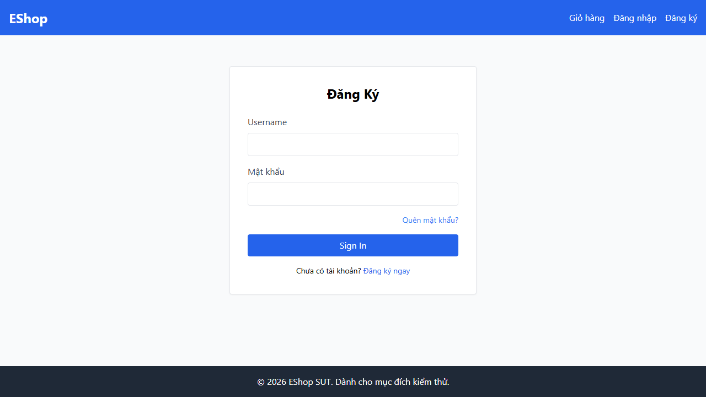

# BUG-FR02-06

> Bản nháp để tạo issue trên repo nhóm (template **Bug report**). Copy từng ô bên dưới vào ô tương ứng của form.

**Tiêu đề issue:** `[23120017][FR-02][Web] Trang Đăng nhập có tiêu đề "Đăng Ký", nhãn "Username", nút "Sign In", thiếu dấu * ở trường bắt buộc`

**Labels:** `bug`, `severity: low`, `platform: web`, `technique: EP`, `pool: A` · **Assignee:** chính mình

| Ô trong form | Nội dung |
|---|---|
| MSSV người báo | 23120017 |
| Feature (mã FR) | FR-02 – Đăng nhập & khóa tài khoản |
| Nền tảng | Web |
| Test case phát hiện lỗi | FR02-EP-09 |
| Mức độ (Severity) | Low |

### Điều kiện tiên quyết
Mở http://localhost:5173/login

### Các bước tái hiện
1. Quan sát tiêu đề form, nhãn các trường và nút submit

### Dữ liệu test
—

### Kết quả mong đợi (theo đặc tả)
FR-21: "Toàn bộ giao diện dùng tiếng Việt"; FR-22: "Tất cả trường bắt buộc phải có ký hiệu `*` bên cạnh nhãn". Tiêu đề phải mô tả đúng trang (Đăng nhập).

### Kết quả thực tế
Tiêu đề form "Đăng Ký" (sai trang), nhãn "Username" và nút "Sign In" (tiếng Anh), không có * ở hai trường bắt buộc.

### Ảnh chụp
Kéo thả các file sau vào ô "Ảnh chụp":
- `evidence/FR02/FR02-EP-09.png`

  

### Môi trường
Windows 11 Home; Microsoft Edge 155.0.4283.62 (điều khiển bằng Playwright 1.48.2) và curl/fetch (Node v22.23.2); EShop commit 85af3ba

### Ghi chú
- Lý do chọn severity: Lỗi giao diện/câu chữ → câu 4.
- Tái hiện: 100 % (chạy lại bằng `scripts/fr02.mjs`).
