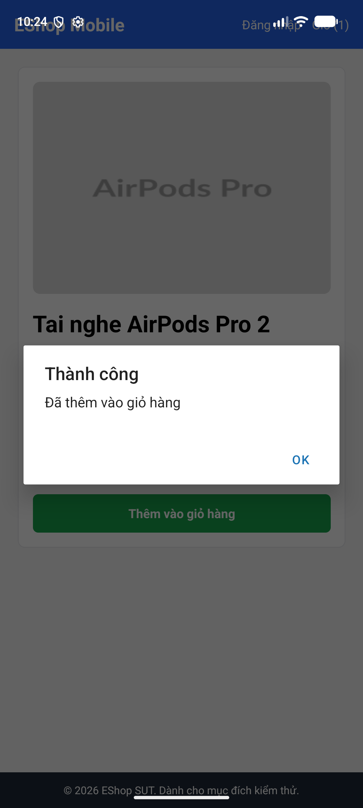
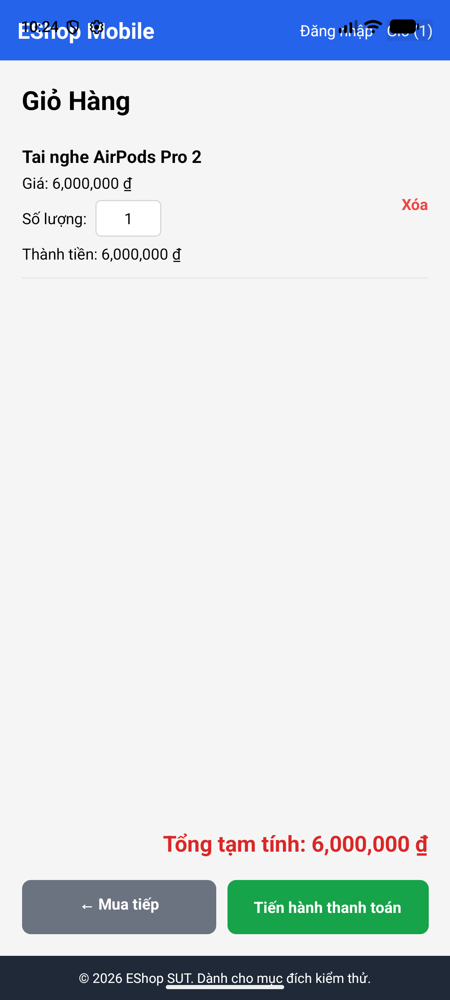

# BUG-FR06-01

> Bản nháp để tạo issue trên repo nhóm (template **Bug report**). Copy từng ô bên dưới vào ô tương ứng của form.

**Tiêu đề issue:** `[23120017][FR-06][Mobile] Ô Số lượng chấp nhận 0, số âm, số thập phân, chữ, ô trống: tự đổi thành 1 và báo "Thành công"`

**Labels:** `bug`, `severity: medium`, `platform: mobile`, `technique: EP`, `technique: BVA`, `pool: D` · **Assignee:** chính mình

| Ô trong form | Nội dung |
|---|---|
| MSSV người báo | 23120017 |
| Feature (mã FR) | FR-06 – Chi tiết sản phẩm |
| Nền tảng | Mobile |
| Test case phát hiện lỗi | FR06-EP-02, FR06-EP-03, FR06-EP-04, FR06-EP-05, FR06-EP-06, FR06-EP-07, FR06-BVA-04 |
| Mức độ (Severity) | Medium |

### Điều kiện tiên quyết
App EShop Mobile (Expo Go, Android Emulator Pixel_6); giỏ hàng trống; mở chi tiết SP "Tai nghe AirPods Pro 2" (6.000.000 ₫)

### Các bước tái hiện
1. Xóa ô Số lượng, nhập 0 (lặp lại với -1, -2, 1.5, abc, để trống, một khoảng trắng)
2. Bấm "Thêm vào giỏ hàng"
3. Mở Giỏ hàng

### Dữ liệu test
0, -1, -2, 1.5, abc, "", " "

### Kết quả mong đợi (theo đặc tả)
FR-06: "Có ô nhập **Số lượng** (chỉ nhận số nguyên dương, tối thiểu là 1)" → giá trị không hợp lệ phải bị từ chối, có thông báo, giỏ hàng không đổi (giả định A2).

### Kết quả thực tế
Mọi giá trị đều hiện hộp thoại "Thành công — Đã thêm vào giỏ hàng"; giỏ có 1 dòng với số lượng 1 (giá trị bị âm thầm đổi thành 1).

### Ảnh chụp
Kéo thả các file sau vào ô "Ảnh chụp":
- `evidence/FR06/FR06-EP-02.png`

  
- `evidence/FR06/FR06-EP-02_cart.png`

  
- `evidence/FR06/FR06-BVA-04_cart.png`

  

### Môi trường
Windows 11 Home; Microsoft Edge 155.0.4283.62 (điều khiển bằng Playwright 1.48.2) và curl/fetch (Node v22.23.2); EShop commit 85af3ba

### Ghi chú
- Lý do chọn severity: Sai validation; người dùng vẫn sửa được số lượng trong giỏ → câu 3. Dựa trên giả định A2 ("chỉ nhận" = chặn).
- Tái hiện: 100 % (chạy lại bằng `scripts/fr06.mjs`).
