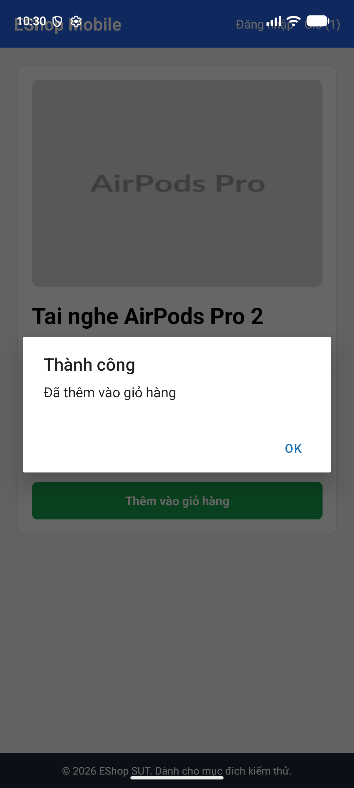
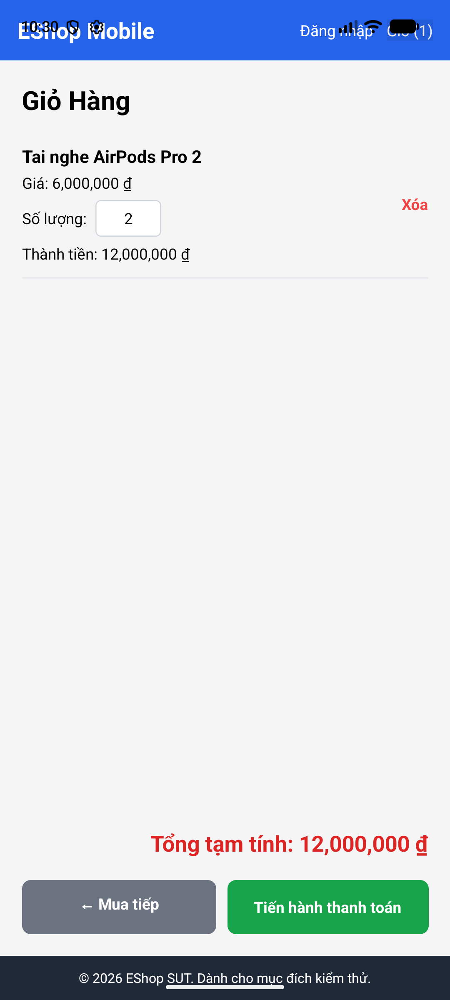

# BUG-FR06-02

> Bản nháp để tạo issue trên repo nhóm (template **Bug report**). Copy từng ô bên dưới vào ô tương ứng của form.

**Tiêu đề issue:** `[23120017][FR-06][Mobile] Ô Số lượng nhận "2abc" thành 2 (chỉ đọc phần số ở đầu chuỗi)`

**Labels:** `bug`, `severity: medium`, `platform: mobile`, `technique: EP`, `pool: D` · **Assignee:** chính mình

| Ô trong form | Nội dung |
|---|---|
| MSSV người báo | 23120017 |
| Feature (mã FR) | FR-06 – Chi tiết sản phẩm |
| Nền tảng | Mobile |
| Test case phát hiện lỗi | FR06-EP-08 |
| Mức độ (Severity) | Medium |

### Điều kiện tiên quyết
App EShop Mobile (Expo Go, Android Emulator Pixel_6); giỏ hàng trống; mở chi tiết SP "Tai nghe AirPods Pro 2" (6.000.000 ₫)

### Các bước tái hiện
1. Nhập 2abc vào ô Số lượng
2. Bấm "Thêm vào giỏ hàng"
3. Mở Giỏ hàng

### Dữ liệu test
2abc

### Kết quả mong đợi (theo đặc tả)
FR-06: chỉ nhận số nguyên dương → "2abc" không phải số nguyên, phải bị từ chối.

### Kết quả thực tế
Báo "Thành công"; giỏ có số lượng 2, thành tiền 12,000,000 ₫.

### Ảnh chụp
Kéo thả các file sau vào ô "Ảnh chụp":
- `evidence/FR06/FR06-EP-08.png`

  
- `evidence/FR06/FR06-EP-08_cart.png`

  

### Môi trường
Windows 11 Home; Microsoft Edge 155.0.4283.62 (điều khiển bằng Playwright 1.48.2) và curl/fetch (Node v22.23.2); EShop commit 85af3ba

### Ghi chú
- Lý do chọn severity: Chấp nhận dữ liệu sai một phần, có cách đi vòng → câu 3.
- Tái hiện: 100 % (chạy lại bằng `scripts/fr06.mjs`).
