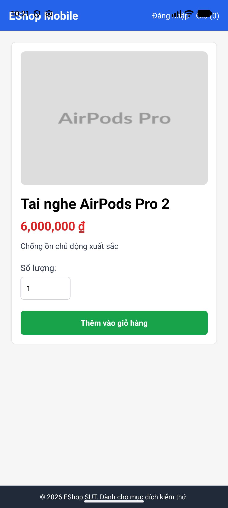

# BUG-FR06-03

> Bản nháp để tạo issue trên repo nhóm (template **Bug report**). Copy từng ô bên dưới vào ô tương ứng của form.

**Tiêu đề issue:** `[23120017][FR-06][Mobile] Màn chi tiết sản phẩm trên Mobile không hiển thị Danh mục`

**Labels:** `bug`, `severity: low`, `platform: mobile`, `technique: EP`, `pool: D` · **Assignee:** chính mình

| Ô trong form | Nội dung |
|---|---|
| MSSV người báo | 23120017 |
| Feature (mã FR) | FR-06 – Chi tiết sản phẩm |
| Nền tảng | Mobile |
| Test case phát hiện lỗi | FR06-EP-11 |
| Mức độ (Severity) | Low |

### Điều kiện tiên quyết
Mở chi tiết SP "Tai nghe AirPods Pro 2" (danh mục Phụ kiện)

### Các bước tái hiện
1. Quan sát các thông tin trên màn chi tiết

### Dữ liệu test
—

### Kết quả mong đợi (theo đặc tả)
FR-06: "Hiển thị đầy đủ: Ảnh lớn, Tên, Giá, Mô tả, Danh mục".

### Kết quả thực tế
Màn hình có ảnh, tên, giá (6,000,000 ₫), mô tả; không có danh mục.

### Ảnh chụp
Kéo thả các file sau vào ô "Ảnh chụp":
- `evidence/FR06/FR06-EP-11.png`

  

### Môi trường
Windows 11 Home; Microsoft Edge 155.0.4283.62 (điều khiển bằng Playwright 1.48.2) và curl/fetch (Node v22.23.2); EShop commit 85af3ba

### Ghi chú
- Lý do chọn severity: Thiếu thông tin hiển thị, không ảnh hưởng dữ liệu → câu 4.
- Tái hiện: 100 % (chạy lại bằng `scripts/fr06.mjs`).
