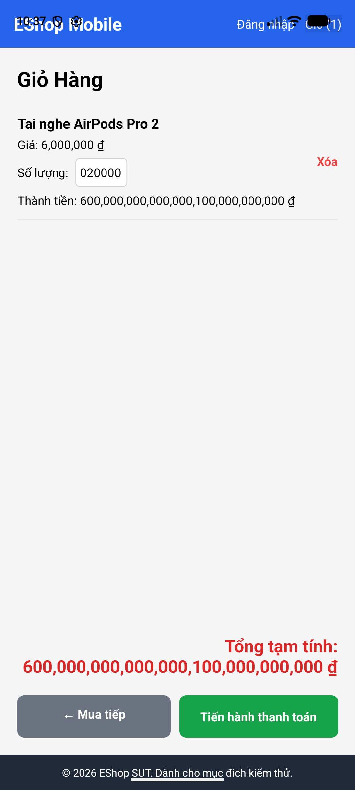

# BUG-FR06-04

> Bản nháp để tạo issue trên repo nhóm (template **Bug report**). Copy từng ô bên dưới vào ô tương ứng của form.

**Tiêu đề issue:** `[23120017][FR-06][Mobile] Số lượng rất lớn bị làm tròn sai (99999999999999999999 thành 100000000000000020000), không có giới hạn trên`

**Labels:** `bug`, `severity: low`, `platform: mobile`, `technique: BVA`, `pool: D` · **Assignee:** chính mình

| Ô trong form | Nội dung |
|---|---|
| MSSV người báo | 23120017 |
| Feature (mã FR) | FR-06 – Chi tiết sản phẩm |
| Nền tảng | Mobile |
| Test case phát hiện lỗi | FR06-BVA-07, FR06-BVA-05, FR06-BVA-06 |
| Mức độ (Severity) | Low |

### Điều kiện tiên quyết
App EShop Mobile (Expo Go, Android Emulator Pixel_6); giỏ hàng trống; mở chi tiết SP "Tai nghe AirPods Pro 2" (6.000.000 ₫)

### Các bước tái hiện
1. Nhập 99999999999999999999 (20 chữ số)
2. Bấm "Thêm vào giỏ hàng"
3. Mở Giỏ hàng

### Dữ liệu test
99999999999999999999; 2147483647; 2147483648

### Kết quả mong đợi (theo đặc tả)
Biên khám phá (giả định A4): số lượng phải được lưu đúng giá trị đã nhập hoặc bị chặn có thông báo; không hiển thị giá trị sai.

### Kết quả thực tế
Giỏ hiển thị số lượng 100000000000000020000 và thành tiền 600,000,000,000,000,100,000,000,000 ₫. Với 2147483647 / 2147483648 vẫn nhận, thành tiền hàng triệu tỷ, không cảnh báo.

### Ảnh chụp
Kéo thả các file sau vào ô "Ảnh chụp":
- `evidence/FR06/FR06-BVA-07_cart.png`

  

### Môi trường
Windows 11 Home; Microsoft Edge 155.0.4283.62 (điều khiển bằng Playwright 1.48.2) và curl/fetch (Node v22.23.2); EShop commit 85af3ba

### Ghi chú
- Lý do chọn severity: Ảnh hưởng nhỏ, dựa trên biên khám phá → câu 4.
- Tái hiện: 100 % (chạy lại bằng `scripts/fr06.mjs`).
