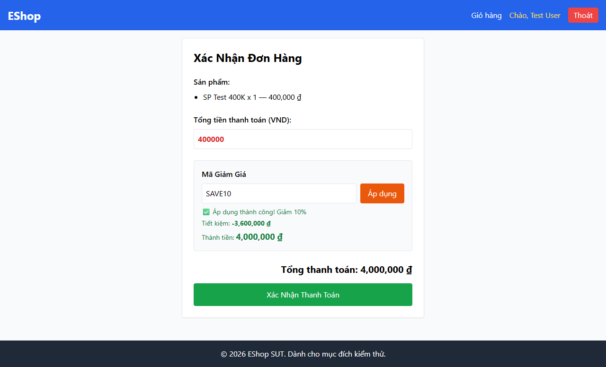
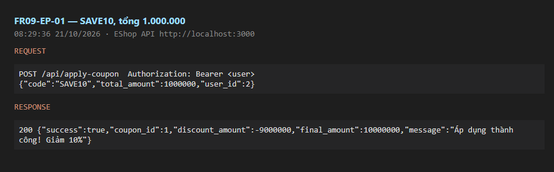

# BUG-FR09-01

> Bản nháp để tạo issue trên repo nhóm (template **Bug report**). Copy từng ô bên dưới vào ô tương ứng của form.

**Tiêu đề issue:** `[23120017][FR-09][Web] Mã percent (SAVE10) tính sai: tiền giảm âm, thành tiền gấp 10 lần tổng đơn`

**Labels:** `bug`, `severity: high`, `platform: web`, `technique: EP`, `technique: BVA`, `pool: B` · **Assignee:** chính mình

| Ô trong form | Nội dung |
|---|---|
| MSSV người báo | 23120017 |
| Feature (mã FR) | FR-09 – Mã giảm giá |
| Nền tảng | Web |
| Test case phát hiện lỗi | FR09-EP-01, FR09-EP-15, FR09-BVA-03 |
| Mức độ (Severity) | High |

### Điều kiện tiên quyết
Đăng nhập test@eshop.com; giỏ có 1 SP giá 400.000 ₫ (SP tạo bằng Admin); ở trang Checkout

### Các bước tái hiện
1. Nhập mã SAVE10
2. Bấm Áp dụng

### Dữ liệu test
SAVE10 (percent 10 %), tổng 400.000 ₫ (UI) / 1.000.000 (API)

### Kết quả mong đợi (theo đặc tả)
FR-09: "`discount_amount = total × discount_value / 100`", "`final_amount = total - discount_amount`" → giảm 40.000 ₫, thành tiền 360.000 ₫.

### Kết quả thực tế
UI: "Tiết kiệm: -3,600,000 ₫ — Thành tiền: 4,000,000 ₫". API với total 1.000.000 → discount_amount -9.000.000, final_amount 10.000.000. Thành tiền = total × 10.

### Ảnh chụp
Kéo thả các file sau vào ô "Ảnh chụp":
- `evidence/FR09/FR09-EP-15.png`

  
- `evidence/FR09/FR09-EP-01.png`

  

### Môi trường
Windows 11 Home; Microsoft Edge 155.0.4283.62 (điều khiển bằng Playwright 1.48.2) và curl/fetch (Node v22.23.2); EShop commit 85af3ba

### Ghi chú
- Lý do chọn severity: Tính sai số tiền phải trả, người dùng không tránh được khi dùng mã percent → câu 2.
- Tái hiện: 100 % (chạy lại bằng `scripts/fr09.mjs`).
