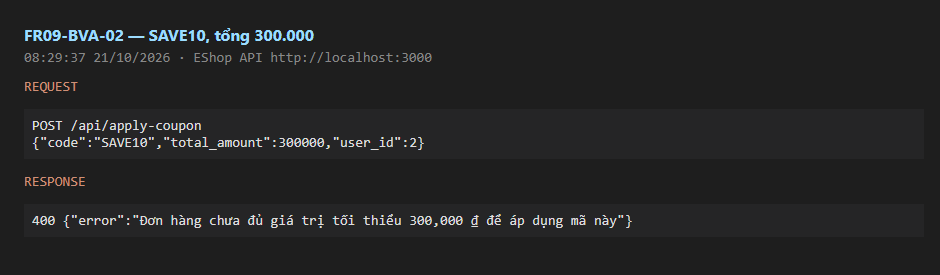
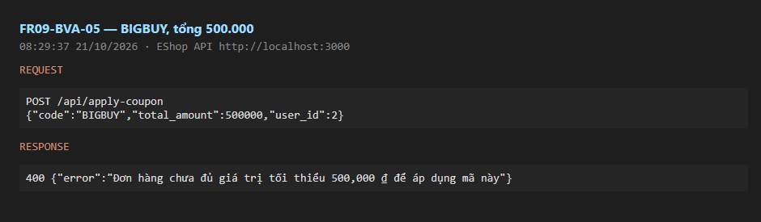
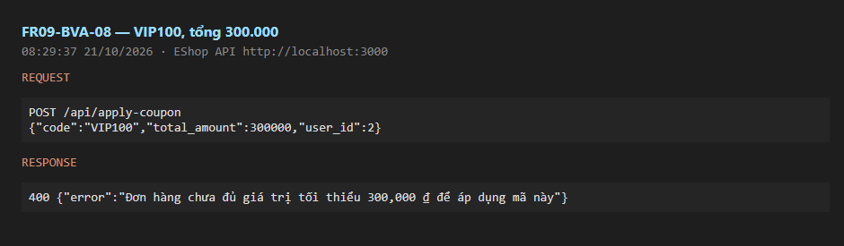

# BUG-FR09-02

> Bản nháp để tạo issue trên repo nhóm (template **Bug report**). Copy từng ô bên dưới vào ô tương ứng của form.

**Tiêu đề issue:** `[23120017][FR-09][Web] Mã bị từ chối khi tổng đơn đúng bằng ngưỡng tối thiểu (dùng > thay cho >=)`

**Labels:** `bug`, `severity: medium`, `platform: web`, `technique: BVA`, `pool: B` · **Assignee:** chính mình

| Ô trong form | Nội dung |
|---|---|
| MSSV người báo | 23120017 |
| Feature (mã FR) | FR-09 – Mã giảm giá |
| Nền tảng | Web |
| Test case phát hiện lỗi | FR09-BVA-02, FR09-BVA-05, FR09-BVA-08 |
| Mức độ (Severity) | Medium |

### Điều kiện tiên quyết
Đăng nhập test@eshop.com (có token); chưa dùng mã nào

### Các bước tái hiện
1. POST /api/apply-coupon {"code":"SAVE10","total_amount":300000,"user_id":2} kèm Bearer token
2. Lặp lại với BIGBUY / 500000 và VIP100 / 300000

### Dữ liệu test
SAVE10 & 300.000; BIGBUY & 500.000; VIP100 & 300.000

### Kết quả mong đợi (theo đặc tả)
FR-09 C3: "Tổng đơn hàng **>= (lớn hơn hoặc bằng)** `min_order_amount`" → cả 3 phải được áp dụng.

### Kết quả thực tế
Cả 3 trả 400 "Đơn hàng chưa đủ giá trị tối thiểu … để áp dụng mã này". Với tổng = ngưỡng + 1 thì được áp dụng (BVA-06, BVA-09).

### Ảnh chụp
Kéo thả các file sau vào ô "Ảnh chụp":
- `evidence/FR09/FR09-BVA-02.png`

  
- `evidence/FR09/FR09-BVA-05.png`

  
- `evidence/FR09/FR09-BVA-08.png`

  

### Môi trường
Windows 11 Home; Microsoft Edge 155.0.4283.62 (điều khiển bằng Playwright 1.48.2) và curl/fetch (Node v22.23.2); EShop commit 85af3ba

### Ghi chú
- Lý do chọn severity: Sai quy tắc nghiệp vụ ở biên; có cách đi vòng (mua thêm) → câu 3.
- Tái hiện: 100 % (chạy lại bằng `scripts/fr09.mjs`).
