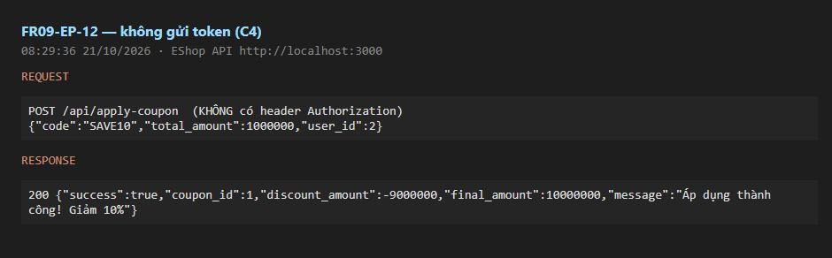
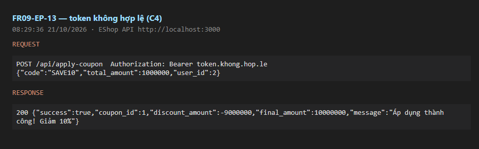

# BUG-FR09-03

> Bản nháp để tạo issue trên repo nhóm (template **Bug report**). Copy từng ô bên dưới vào ô tương ứng của form.

**Tiêu đề issue:** `[23120017][FR-09][Web] API áp mã giảm giá không yêu cầu đăng nhập (không token / token sai vẫn áp dụng được)`

**Labels:** `bug`, `severity: critical`, `platform: web`, `technique: EP`, `pool: B` · **Assignee:** chính mình

| Ô trong form | Nội dung |
|---|---|
| MSSV người báo | 23120017 |
| Feature (mã FR) | FR-09 – Mã giảm giá |
| Nền tảng | Web |
| Test case phát hiện lỗi | FR09-EP-12, FR09-EP-13 |
| Mức độ (Severity) | Critical |

### Điều kiện tiên quyết
Không đăng nhập

### Các bước tái hiện
1. POST /api/apply-coupon {"code":"SAVE10","total_amount":1000000,"user_id":2} **không** có header Authorization
2. Lặp lại với header Authorization: Bearer token.khong.hop.le

### Dữ liệu test
SAVE10, total 1.000.000

### Kết quả mong đợi (theo đặc tả)
FR-09 C4: "Người dùng phải có JWT Token hợp lệ"; SEC-02. Phải trả 401.

### Kết quả thực tế
Cả hai trả 200 {"success":true, …}. Mã được áp dụng cho người chưa đăng nhập, và cho bất kỳ user_id nào client tự điền.

### Ảnh chụp
Kéo thả các file sau vào ô "Ảnh chụp":
- `evidence/FR09/FR09-EP-12.png`

  
- `evidence/FR09/FR09-EP-13.png`

  

### Môi trường
Windows 11 Home; Microsoft Edge 155.0.4283.62 (điều khiển bằng Playwright 1.48.2) và curl/fetch (Node v22.23.2); EShop commit 85af3ba

### Ghi chú
- Lý do chọn severity: Vượt quyền (bỏ qua xác thực) → câu 1.
- Tái hiện: 100 % (chạy lại bằng `scripts/fr09.mjs`).
