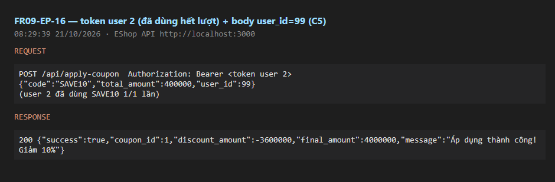

# BUG-FR09-04

> Bản nháp để tạo issue trên repo nhóm (template **Bug report**). Copy từng ô bên dưới vào ô tương ứng của form.

**Tiêu đề issue:** `[23120017][FR-09][Web] Giới hạn số lần dùng mã bị vượt qua bằng cách đổi user_id trong request`

**Labels:** `bug`, `severity: critical`, `platform: web`, `technique: EP`, `pool: B` · **Assignee:** chính mình

| Ô trong form | Nội dung |
|---|---|
| MSSV người báo | 23120017 |
| Feature (mã FR) | FR-09 – Mã giảm giá |
| Nền tảng | Web |
| Test case phát hiện lỗi | FR09-EP-16 |
| Mức độ (Severity) | Critical |

### Điều kiện tiên quyết
test@eshop.com (id 2) đã dùng SAVE10 1/1 lần (đặt hàng có SAVE10, hoặc POST /api/coupon-usage)

### Các bước tái hiện
1. Áp SAVE10 bình thường → bị từ chối "đã đạt giới hạn" (FR09-EP-14)
2. Gửi POST /api/apply-coupon với token của test@ nhưng body "user_id": 99

### Dữ liệu test
{"code":"SAVE10","total_amount":400000,"user_id":99} + Bearer <token test@>

### Kết quả mong đợi (theo đặc tả)
FR-09 C5: "Số lần đã dùng mã này **của user** < `max_uses_per_user`"; user phải lấy từ JWT (C4). Phải từ chối.

### Kết quả thực tế
200 — áp dụng thành công. Lượt dùng được tính theo user_id do client gửi, nên mỗi user dùng được mã vô hạn lần.

### Ảnh chụp
Kéo thả các file sau vào ô "Ảnh chụp":
- `evidence/FR09/FR09-EP-16.png`

  

### Môi trường
Windows 11 Home; Microsoft Edge 155.0.4283.62 (điều khiển bằng Playwright 1.48.2) và curl/fetch (Node v22.23.2); EShop commit 85af3ba

### Ghi chú
- Lý do chọn severity: Vượt quyền / lạm dụng khuyến mãi không giới hạn → câu 1.
- Tái hiện: 100 % (chạy lại bằng `scripts/fr09.mjs`).
