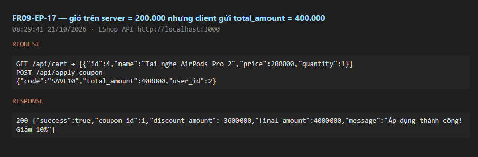

# BUG-FR09-05

> Bản nháp để tạo issue trên repo nhóm (template **Bug report**). Copy từng ô bên dưới vào ô tương ứng của form.

**Tiêu đề issue:** `[23120017][FR-09][Web] Điều kiện ngưỡng đơn hàng dựa trên total_amount do client gửi, không theo giỏ hàng thật`

**Labels:** `bug`, `severity: high`, `platform: web`, `technique: EP`, `pool: B` · **Assignee:** chính mình

| Ô trong form | Nội dung |
|---|---|
| MSSV người báo | 23120017 |
| Feature (mã FR) | FR-09 – Mã giảm giá |
| Nền tảng | Web |
| Test case phát hiện lỗi | FR09-EP-17 |
| Mức độ (Severity) | High |

### Điều kiện tiên quyết
Giỏ trên server của test@ chỉ có 1 SP 200.000 ₫ (POST /api/cart)

### Các bước tái hiện
1. GET /api/cart → tổng 200.000
2. POST /api/apply-coupon {"code":"SAVE10","total_amount":400000,"user_id":2} kèm token

### Dữ liệu test
Giỏ thật 200.000; total_amount khai 400.000

### Kết quả mong đợi (theo đặc tả)
FR-09 C3 ("Tổng đơn hàng") kết hợp FR-08: "Backend phải tự tính lại tổng tiền; không chấp nhận giá trị `total_amount` do client gửi lên". Phải từ chối vì 200.000 &lt; 300.000.

### Kết quả thực tế
200 — áp dụng thành công dựa trên 400.000 client khai. (Trên UI, ô "Tổng tiền thanh toán" ở Checkout còn sửa tay được — lỗi FR-08.)

### Ảnh chụp
Kéo thả các file sau vào ô "Ảnh chụp":
- `evidence/FR09/FR09-EP-17.png`

  

### Môi trường
Windows 11 Home; Microsoft Edge 155.0.4283.62 (điều khiển bằng Playwright 1.48.2) và curl/fetch (Node v22.23.2); EShop commit 85af3ba

### Ghi chú
- Lý do chọn severity: Hệ thống chấp nhận dữ liệu sai từ client làm sai điều kiện khuyến mãi → câu 2.
- Tái hiện: 100 % (chạy lại bằng `scripts/fr09.mjs`).
- Liên quan FR-08 (Hương): ô Tổng tiền ở Checkout sửa được và backend tin total_amount.
