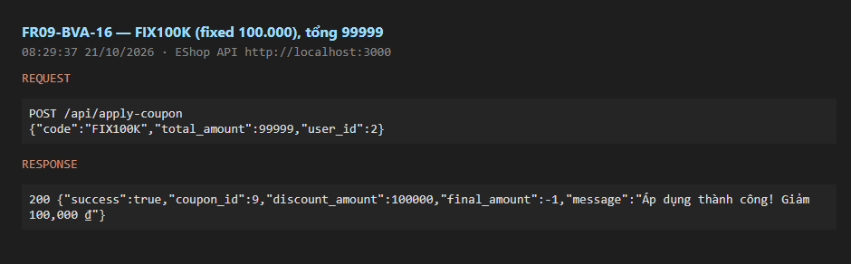

# BUG-FR09-06

> Bản nháp để tạo issue trên repo nhóm (template **Bug report**). Copy từng ô bên dưới vào ô tương ứng của form.

**Tiêu đề issue:** `[23120017][FR-09][Web] Thành tiền bị âm khi mã fixed lớn hơn tổng đơn`

**Labels:** `bug`, `severity: medium`, `platform: web`, `technique: BVA`, `pool: B` · **Assignee:** chính mình

| Ô trong form | Nội dung |
|---|---|
| MSSV người báo | 23120017 |
| Feature (mã FR) | FR-09 – Mã giảm giá |
| Nền tảng | Web |
| Test case phát hiện lỗi | FR09-BVA-16 |
| Mức độ (Severity) | Medium |

### Điều kiện tiên quyết
Admin tạo coupon FIX100K: fixed 100.000, min_order_amount 0, hạn 2099-12-31

### Các bước tái hiện
1. POST /api/apply-coupon {"code":"FIX100K","total_amount":99999,"user_id":2} kèm token

### Dữ liệu test
FIX100K, total 99.999

### Kết quả mong đợi (theo đặc tả)
FR-09: `final_amount = total - discount_amount` là số tiền phải trả nên không được âm (giả định A7: giảm tối đa bằng tổng đơn → 0).

### Kết quả thực tế
200 {"discount_amount":100000,"final_amount":-1}.

### Ảnh chụp
Kéo thả các file sau vào ô "Ảnh chụp":
- `evidence/FR09/FR09-BVA-16.png`

  

### Môi trường
Windows 11 Home; Microsoft Edge 155.0.4283.62 (điều khiển bằng Playwright 1.48.2) và curl/fetch (Node v22.23.2); EShop commit 85af3ba

### Ghi chú
- Lý do chọn severity: Tính sai output ở biên; tình huống chỉ xảy ra khi admin tạo mã có min nhỏ hơn giá trị giảm → câu 3. Dựa trên giả định A7.
- Tái hiện: 100 % (chạy lại bằng `scripts/fr09.mjs`).
