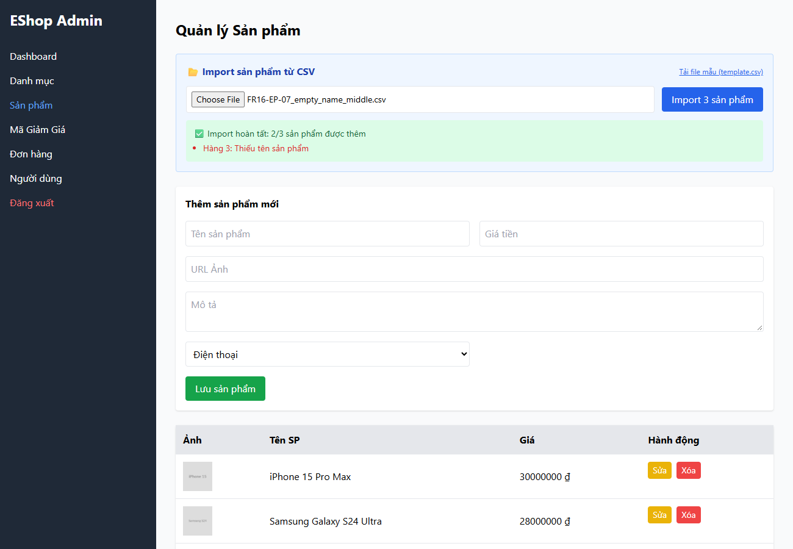
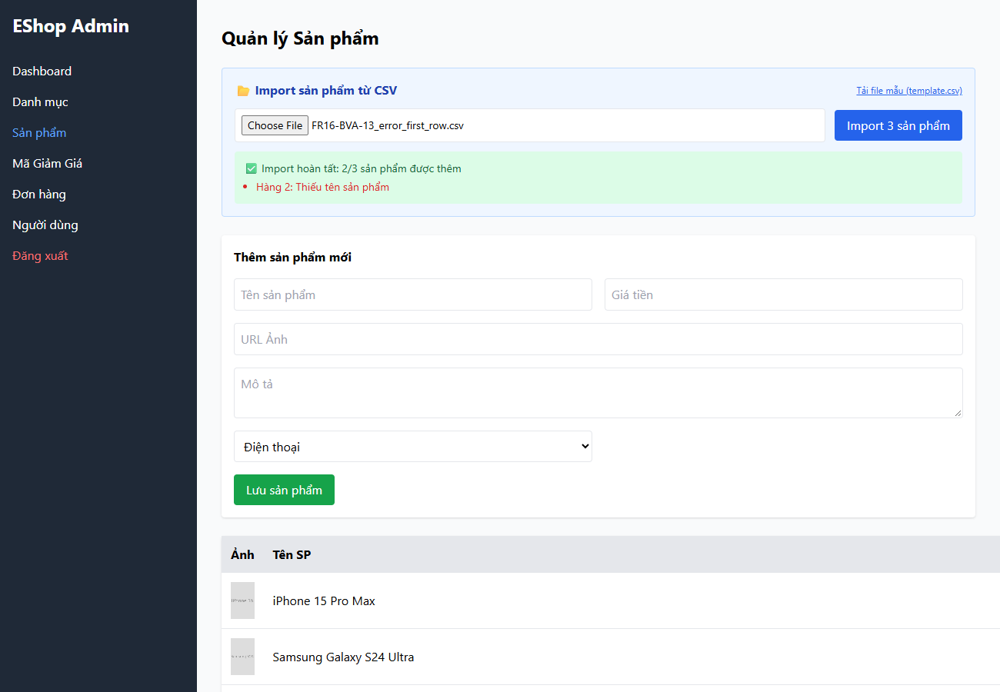

# BUG-FR16-01

> Bản nháp để tạo issue trên repo nhóm (template **Bug report**). Copy từng ô bên dưới vào ô tương ứng của form.

**Tiêu đề issue:** `[23120017][FR-16][Admin] Import CSV không rollback: dòng lỗi bị bỏ qua, các dòng còn lại vẫn được thêm`

**Labels:** `bug`, `severity: high`, `platform: admin`, `technique: EP`, `technique: BVA`, `pool: C` · **Assignee:** chính mình

| Ô trong form | Nội dung |
|---|---|
| MSSV người báo | 23120017 |
| Feature (mã FR) | FR-16 – Import sản phẩm từ CSV |
| Nền tảng | Web Admin |
| Test case phát hiện lỗi | FR16-EP-07, FR16-EP-15, FR16-BVA-13 |
| Mức độ (Severity) | High |

### Điều kiện tiên quyết
Đăng nhập Web Admin → Sản phẩm → Import CSV; đếm số SP trước khi import

### Các bước tái hiện
1. Chọn file test-data/FR16/FR16-EP-07_empty_name_middle.csv (3 dòng, dòng 2 name rỗng)
2. Bấm "Import 3 sản phẩm"
3. Kiểm tra danh sách sản phẩm

### Dữ liệu test
FR16-EP-07_empty_name_middle.csv; FR16-BVA-13_error_first_row.csv

### Kết quả mong đợi (theo đặc tả)
FR-16: "Nếu có lỗi ở bất kỳ dòng nào, toàn bộ import phải được **rollback** (giao dịch nguyên tử — all-or-nothing)" → 0 SP được thêm.

### Kết quả thực tế
Báo "✅ Import hoàn tất: 2/3 sản phẩm được thêm — Hàng 3: Thiếu tên sản phẩm"; DB thêm 2 SP. Lặp lại khi dòng lỗi ở đầu file (BVA-13) và khi tên chỉ có khoảng trắng (EP-15).

### Ảnh chụp
Kéo thả các file sau vào ô "Ảnh chụp":
- `evidence/FR16/FR16-EP-07.png`

  
- `evidence/FR16/FR16-BVA-13.png`

  

### Môi trường
Windows 11 Home; Microsoft Edge 155.0.4283.62 (điều khiển bằng Playwright 1.48.2) và curl/fetch (Node v22.23.2); EShop commit 85af3ba

### Ghi chú
- Lý do chọn severity: Dữ liệu import dở dang lọt vào DB, admin không tránh được → câu 2.
- Tái hiện: 100 % (chạy lại bằng `scripts/fr16.mjs`).
