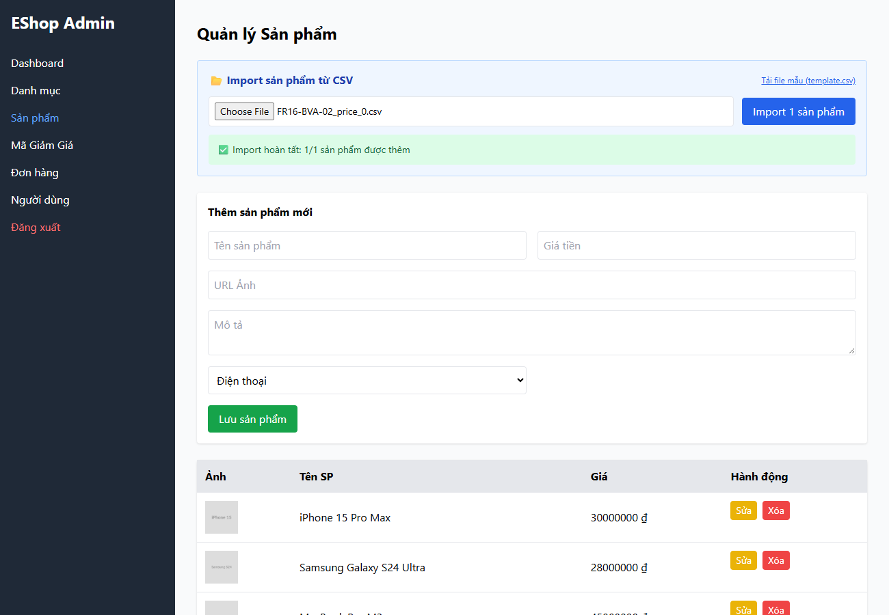
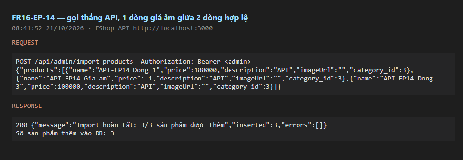

# BUG-FR16-02

> Bản nháp để tạo issue trên repo nhóm (template **Bug report**). Copy từng ô bên dưới vào ô tương ứng của form.

**Tiêu đề issue:** `[23120017][FR-16][Admin] Import CSV chấp nhận giá bằng 0, giá âm và giá không phải số`

**Labels:** `bug`, `severity: high`, `platform: admin`, `technique: EP`, `technique: BVA`, `pool: C` · **Assignee:** chính mình

| Ô trong form | Nội dung |
|---|---|
| MSSV người báo | 23120017 |
| Feature (mã FR) | FR-16 – Import sản phẩm từ CSV |
| Nền tảng | Web Admin |
| Test case phát hiện lỗi | FR16-EP-08, FR16-EP-09, FR16-EP-10, FR16-EP-14, FR16-BVA-01, FR16-BVA-02, FR16-BVA-14 |
| Mức độ (Severity) | High |

### Điều kiện tiên quyết
Đăng nhập Web Admin → Sản phẩm → Import CSV

### Các bước tái hiện
1. Import FR16-BVA-02_price_0.csv (price = 0)
2. Import FR16-EP-09_price_negative.csv (price = -5000) và FR16-EP-10_price_text.csv (price = abc)
3. Gọi thẳng POST /api/admin/import-products với 1 dòng price = -1 (test-data/FR16/api/FR16-EP-14_body.json)

### Dữ liệu test
price = 0, -0.01, -5000, "abc", -1

### Kết quả mong đợi (theo đặc tả)
FR-16: "`price` phải là số dương". Dòng lỗi phải bị từ chối (và cả file rollback).

### Kết quả thực tế
Tất cả đều báo thành công và được lưu: SP giá 0, -0.01, -5000, "abc". Gọi thẳng API cũng không validate (3/3 được thêm).

### Ảnh chụp
Kéo thả các file sau vào ô "Ảnh chụp":
- `evidence/FR16/FR16-BVA-02.png`

  
- `evidence/FR16/FR16-EP-10.png`

  
- `evidence/FR16/FR16-EP-14.png`

  

### Môi trường
Windows 11 Home; Microsoft Edge 155.0.4283.62 (điều khiển bằng Playwright 1.48.2) và curl/fetch (Node v22.23.2); EShop commit 85af3ba

### Ghi chú
- Lý do chọn severity: Dữ liệu sai lọt vào DB (sản phẩm giá 0/âm/chữ), không có cách chặn → câu 2.
- Tái hiện: 100 % (chạy lại bằng `scripts/fr16.mjs`).
