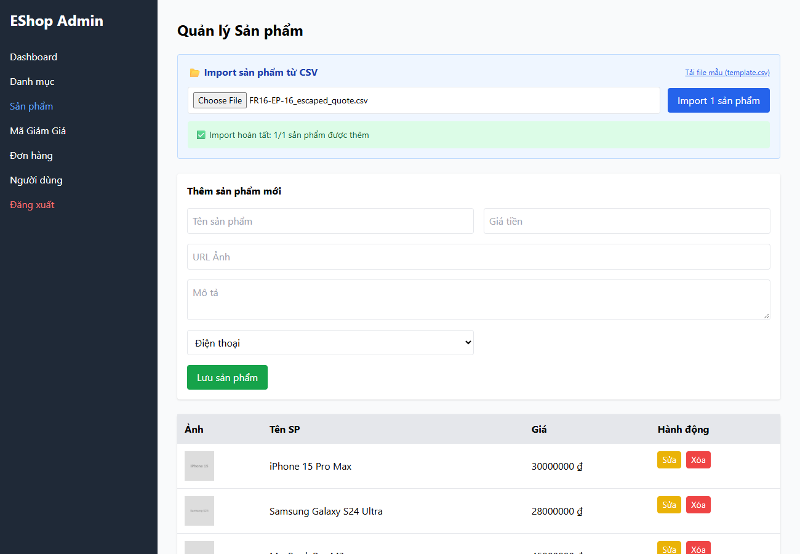

# BUG-FR16-03

> Bản nháp để tạo issue trên repo nhóm (template **Bug report**). Copy từng ô bên dưới vào ô tương ứng của form.

**Tiêu đề issue:** `[23120017][FR-16][Admin] Import CSV không hỗ trợ trường có dấu phẩy bọc nháy kép (RFC 4180), dữ liệu bị lệch cột`

**Labels:** `bug`, `severity: medium`, `platform: admin`, `technique: EP`, `pool: C` · **Assignee:** chính mình

| Ô trong form | Nội dung |
|---|---|
| MSSV người báo | 23120017 |
| Feature (mã FR) | FR-16 – Import sản phẩm từ CSV |
| Nền tảng | Web Admin |
| Test case phát hiện lỗi | FR16-EP-06, FR16-EP-16 |
| Mức độ (Severity) | Medium |

### Điều kiện tiên quyết
Đăng nhập Web Admin → Sản phẩm → Import CSV

### Các bước tái hiện
1. Import FR16-EP-06_quoted_comma.csv có dòng: "CSV-EP06 Laptop, Pro",25000000,"Mo ta, co dau phay",…,2
2. Kiểm tra sản phẩm được tạo

### Dữ liệu test
FR16-EP-06_quoted_comma.csv; FR16-EP-16_escaped_quote.csv

### Kết quả mong đợi (theo đặc tả)
FR-16: "Hỗ trợ các trường có chứa dấu phẩy nếu được bọc trong dấu nháy kép (RFC 4180)" → tên "CSV-EP06 Laptop, Pro", giá 25.000.000, danh mục 2.

### Kết quả thực tế
Báo thành công nhưng lưu sai: name = "\"CSV-EP06 Laptop", price = " Pro\"", category_id = 1. Với nháy kép escape (EP-16) tên bị giữ nguyên các dấu ".

### Ảnh chụp
Kéo thả các file sau vào ô "Ảnh chụp":
- `evidence/FR16/FR16-EP-06.png`

  
- `evidence/FR16/FR16-EP-16.png`

  

### Môi trường
Windows 11 Home; Microsoft Edge 155.0.4283.62 (điều khiển bằng Playwright 1.48.2) và curl/fetch (Node v22.23.2); EShop commit 85af3ba

### Ghi chú
- Lý do chọn severity: Sai nghiệp vụ; đi vòng được bằng cách không dùng dấu phẩy → câu 3.
- Tái hiện: 100 % (chạy lại bằng `scripts/fr16.mjs`).
