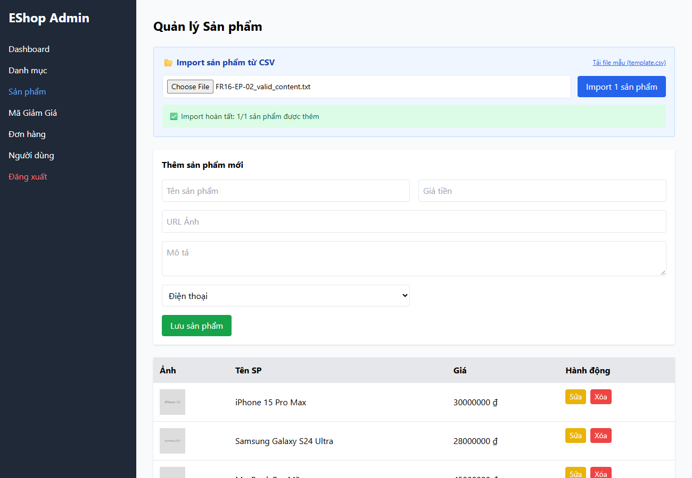
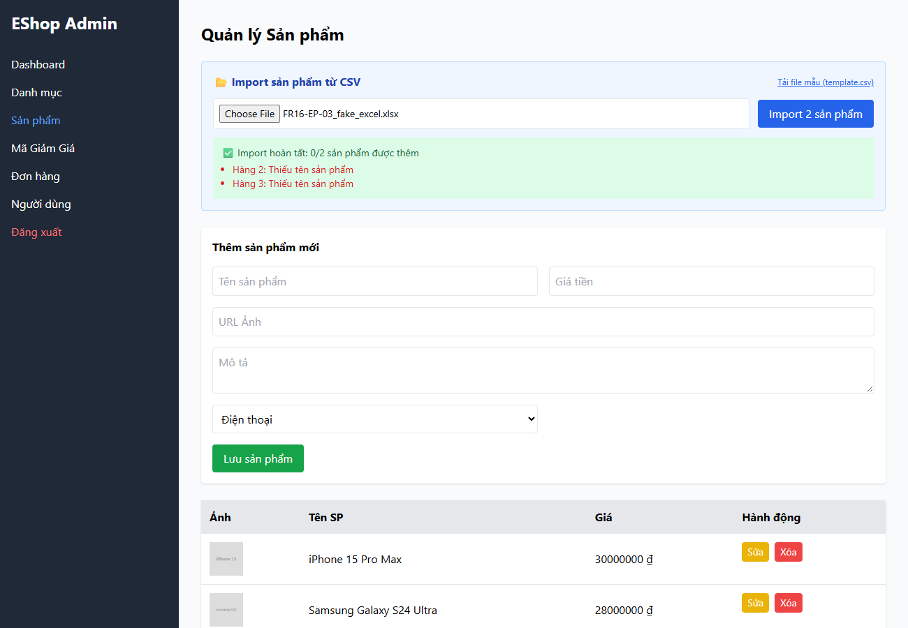

# BUG-FR16-04

> Bản nháp để tạo issue trên repo nhóm (template **Bug report**). Copy từng ô bên dưới vào ô tương ứng của form.

**Tiêu đề issue:** `[23120017][FR-16][Admin] Import CSV không kiểm tra đuôi/loại file (.txt được import, file nhị phân bị đọc như CSV)`

**Labels:** `bug`, `severity: medium`, `platform: admin`, `technique: EP`, `pool: C` · **Assignee:** chính mình

| Ô trong form | Nội dung |
|---|---|
| MSSV người báo | 23120017 |
| Feature (mã FR) | FR-16 – Import sản phẩm từ CSV |
| Nền tảng | Web Admin |
| Test case phát hiện lỗi | FR16-EP-02, FR16-EP-03 |
| Mức độ (Severity) | Medium |

### Điều kiện tiên quyết
Đăng nhập Web Admin → Sản phẩm → Import CSV

### Các bước tái hiện
1. Chọn FR16-EP-02_valid_content.txt → Import
2. Chọn FR16-EP-03_fake_excel.xlsx → Import

### Dữ liệu test
.txt có nội dung CSV; .xlsx nhị phân

### Kết quả mong đợi (theo đặc tả)
FR-16: "Đuôi file phải là `.csv`" → từ chối file, báo sai định dạng.

### Kết quả thực tế
.txt: "Import hoàn tất: 1/1", SP được thêm. .xlsx: hệ thống đọc nội dung nhị phân như CSV và báo "0/2 … Hàng 2: Thiếu tên sản phẩm" (không báo sai định dạng). Ô chọn file không có thuộc tính accept.

### Ảnh chụp
Kéo thả các file sau vào ô "Ảnh chụp":
- `evidence/FR16/FR16-EP-02.png`

  
- `evidence/FR16/FR16-EP-03.png`

  

### Môi trường
Windows 11 Home; Microsoft Edge 155.0.4283.62 (điều khiển bằng Playwright 1.48.2) và curl/fetch (Node v22.23.2); EShop commit 85af3ba

### Ghi chú
- Lý do chọn severity: Sai validation, có cách đi vòng → câu 3.
- Tái hiện: 100 % (chạy lại bằng `scripts/fr16.mjs`).
