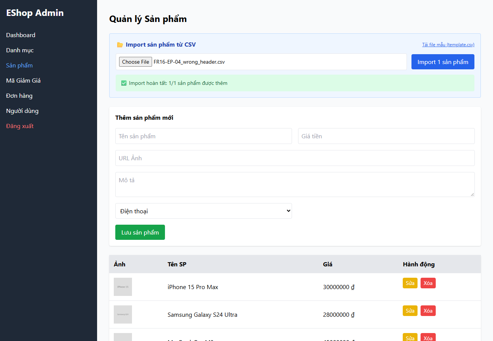
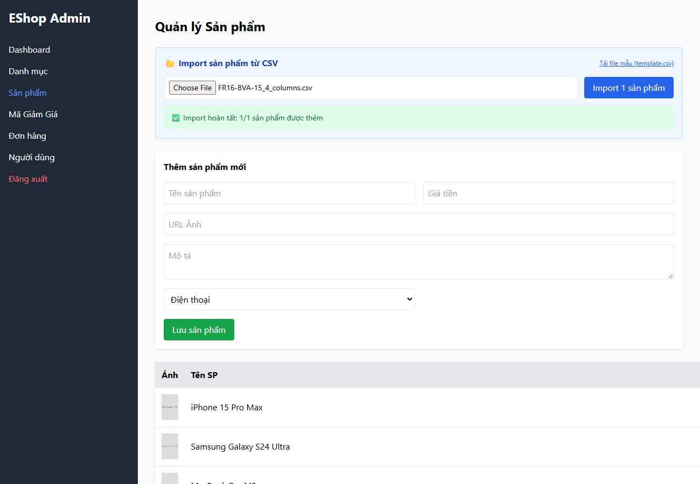
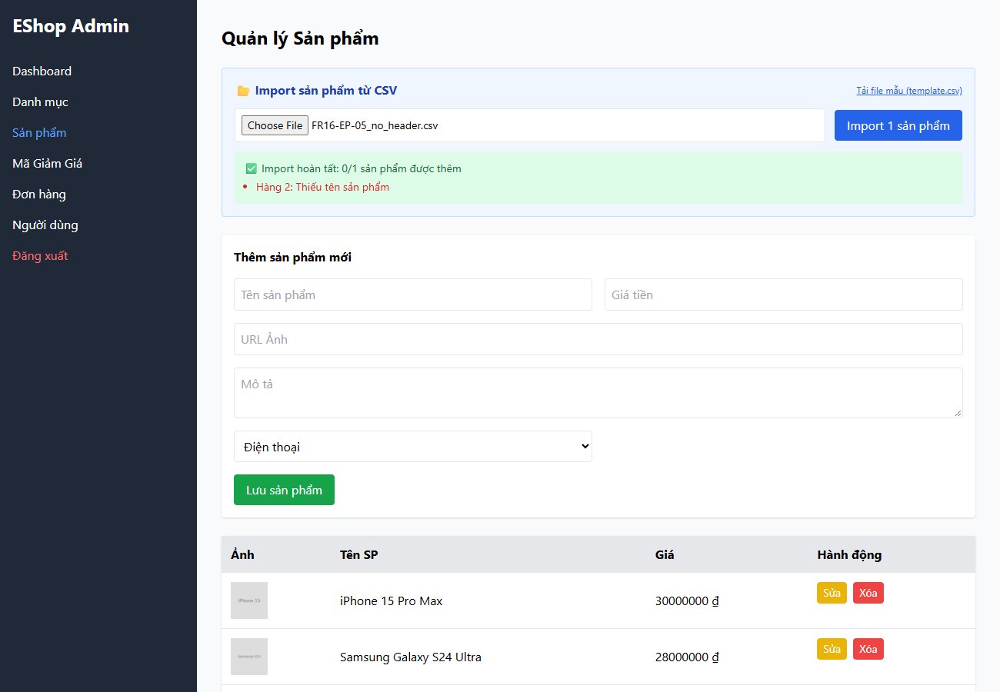

# BUG-FR16-05

> Bản nháp để tạo issue trên repo nhóm (template **Bug report**). Copy từng ô bên dưới vào ô tương ứng của form.

**Tiêu đề issue:** `[23120017][FR-16][Admin] Import CSV không kiểm tra header (sai tên cột, thiếu/thừa cột, không có header vẫn xử lý)`

**Labels:** `bug`, `severity: medium`, `platform: admin`, `technique: EP`, `technique: BVA`, `pool: C` · **Assignee:** chính mình

| Ô trong form | Nội dung |
|---|---|
| MSSV người báo | 23120017 |
| Feature (mã FR) | FR-16 – Import sản phẩm từ CSV |
| Nền tảng | Web Admin |
| Test case phát hiện lỗi | FR16-EP-04, FR16-EP-05, FR16-EP-19, FR16-BVA-15, FR16-BVA-16 |
| Mức độ (Severity) | Medium |

### Điều kiện tiên quyết
Đăng nhập Web Admin → Sản phẩm → Import CSV

### Các bước tái hiện
1. Import FR16-EP-04_wrong_header.csv (header ten,gia,mo_ta,image,danh_muc)
2. Import FR16-BVA-15_4_columns.csv (thiếu category_id) và FR16-BVA-16_6_columns.csv (thừa cột stock)
3. Import FR16-EP-05_no_header.csv (không có header)

### Dữ liệu test
Các file trên

### Kết quả mong đợi (theo đặc tả)
FR-16: "Dòng đầu tiên là header: `name,price,description,imageUrl,category_id`" → header sai phải bị từ chối với thông báo rõ ràng.

### Kết quả thực tế
Header tiếng Việt, đổi thứ tự, 4 cột, 6 cột đều được import thành công (thiếu category_id thì tự gán danh mục 1). File không có header: dòng dữ liệu đầu bị coi là header, báo "Thiếu tên sản phẩm" thay vì báo lỗi header.

### Ảnh chụp
Kéo thả các file sau vào ô "Ảnh chụp":
- `evidence/FR16/FR16-EP-04.png`

  
- `evidence/FR16/FR16-BVA-15.png`

  
- `evidence/FR16/FR16-EP-05.png`

  

### Môi trường
Windows 11 Home; Microsoft Edge 155.0.4283.62 (điều khiển bằng Playwright 1.48.2) và curl/fetch (Node v22.23.2); EShop commit 85af3ba

### Ghi chú
- Lý do chọn severity: Sai validation, có cách đi vòng (dùng đúng file mẫu) → câu 3.
- Tái hiện: 100 % (chạy lại bằng `scripts/fr16.mjs`).
