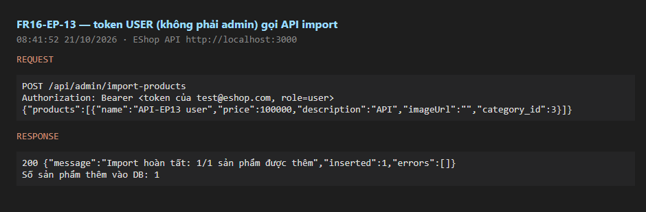

# BUG-FR16-06

> Bản nháp để tạo issue trên repo nhóm (template **Bug report**). Copy từng ô bên dưới vào ô tương ứng của form.

**Tiêu đề issue:** `[23120017][FR-16][Admin] Tài khoản user thường gọi được API import sản phẩm (không kiểm tra role admin)`

**Labels:** `bug`, `severity: critical`, `platform: admin`, `technique: EP`, `pool: C` · **Assignee:** chính mình

| Ô trong form | Nội dung |
|---|---|
| MSSV người báo | 23120017 |
| Feature (mã FR) | FR-16 – Import sản phẩm từ CSV |
| Nền tảng | Web Admin |
| Test case phát hiện lỗi | FR16-EP-13 |
| Mức độ (Severity) | Critical |

### Điều kiện tiên quyết
Đăng nhập API bằng test@eshop.com (role = user) lấy token

### Các bước tái hiện
1. POST /api/admin/import-products {"products":[{"name":"API-EP13 user","price":100000,…}]} kèm Bearer <token user>
2. GET /api/products

### Dữ liệu test
Token của test@eshop.com

### Kết quả mong đợi (theo đặc tả)
FR-12: API Admin phải yêu cầu "`role = 'admin'` trong Token"; SEC-03. Phải trả 403.

### Kết quả thực tế
200 "Import hoàn tất: 1/1 sản phẩm được thêm"; sản phẩm xuất hiện trên cửa hàng.

### Ảnh chụp
Kéo thả các file sau vào ô "Ảnh chụp":
- `evidence/FR16/FR16-EP-13.png`

  

### Môi trường
Windows 11 Home; Microsoft Edge 155.0.4283.62 (điều khiển bằng Playwright 1.48.2) và curl/fetch (Node v22.23.2); EShop commit 85af3ba

### Ghi chú
- Lý do chọn severity: Vượt quyền: user thường thêm được sản phẩm → câu 1.
- Tái hiện: 100 % (chạy lại bằng `scripts/fr16.mjs`).
- Cùng nhóm lỗi phân quyền FR-12 (chưa ai nhận FR-12).
