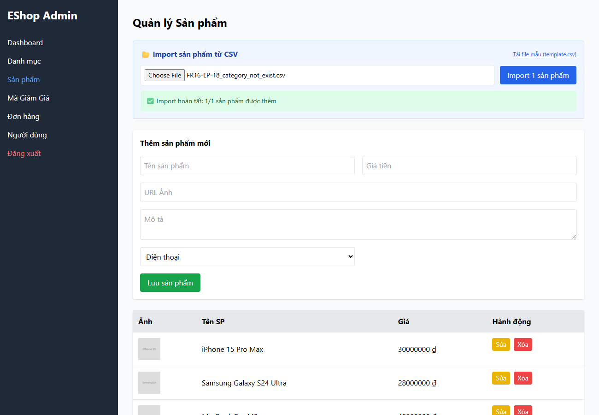

# BUG-FR16-07

> Bản nháp để tạo issue trên repo nhóm (template **Bug report**). Copy từng ô bên dưới vào ô tương ứng của form.

**Tiêu đề issue:** `[23120017][FR-16][Admin] Import CSV chấp nhận category_id không tồn tại`

**Labels:** `bug`, `severity: medium`, `platform: admin`, `technique: EP`, `pool: C` · **Assignee:** chính mình

| Ô trong form | Nội dung |
|---|---|
| MSSV người báo | 23120017 |
| Feature (mã FR) | FR-16 – Import sản phẩm từ CSV |
| Nền tảng | Web Admin |
| Test case phát hiện lỗi | FR16-EP-18 |
| Mức độ (Severity) | Medium |

### Điều kiện tiên quyết
Danh mục hiện có: 1, 2, 3

### Các bước tái hiện
1. Import FR16-EP-18_category_not_exist.csv (category_id = 99)

### Dữ liệu test
category_id = 99

### Kết quả mong đợi (theo đặc tả)
Giả định A6 dựa trên FR-15 ("Danh mục: bắt buộc, phải chọn từ danh sách có sẵn"): dòng có danh mục không tồn tại phải bị từ chối.

### Kết quả thực tế
Import thành công, SP lưu với category_id = 99 (danh mục không tồn tại).

### Ảnh chụp
Kéo thả các file sau vào ô "Ảnh chụp":
- `evidence/FR16/FR16-EP-18.png`

  

### Môi trường
Windows 11 Home; Microsoft Edge 155.0.4283.62 (điều khiển bằng Playwright 1.48.2) và curl/fetch (Node v22.23.2); EShop commit 85af3ba

### Ghi chú
- Lý do chọn severity: Dữ liệu tham chiếu sai, có cách đi vòng → câu 3. Dựa trên giả định A6.
- Tái hiện: 100 % (chạy lại bằng `scripts/fr16.mjs`).
