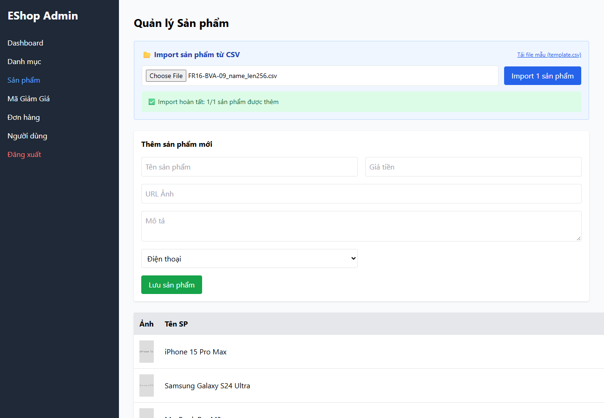

# BUG-FR16-08

> Bản nháp để tạo issue trên repo nhóm (template **Bug report**). Copy từng ô bên dưới vào ô tương ứng của form.

**Tiêu đề issue:** `[23120017][FR-16][Admin] Import CSV chấp nhận tên sản phẩm dài 256 ký tự (vượt giới hạn 255)`

**Labels:** `bug`, `severity: low`, `platform: admin`, `technique: BVA`, `pool: C` · **Assignee:** chính mình

| Ô trong form | Nội dung |
|---|---|
| MSSV người báo | 23120017 |
| Feature (mã FR) | FR-16 – Import sản phẩm từ CSV |
| Nền tảng | Web Admin |
| Test case phát hiện lỗi | FR16-BVA-09 |
| Mức độ (Severity) | Low |

### Điều kiện tiên quyết
Đăng nhập Web Admin → Sản phẩm → Import CSV

### Các bước tái hiện
1. Import FR16-BVA-09_name_len256.csv (name 256 ký tự)

### Dữ liệu test
name = 256 × "L"

### Kết quả mong đợi (theo đặc tả)
Giả định A5 dựa trên FR-15 ("Tên sản phẩm: bắt buộc, tối đa 255 ký tự"): 256 ký tự phải bị từ chối.

### Kết quả thực tế
Import thành công, tên 256 ký tự được lưu.

### Ảnh chụp
Kéo thả các file sau vào ô "Ảnh chụp":
- `evidence/FR16/FR16-BVA-09.png`

  

### Môi trường
Windows 11 Home; Microsoft Edge 155.0.4283.62 (điều khiển bằng Playwright 1.48.2) và curl/fetch (Node v22.23.2); EShop commit 85af3ba

### Ghi chú
- Lý do chọn severity: Ảnh hưởng nhỏ, dựa trên giả định → câu 4.
- Tái hiện: 100 % (chạy lại bằng `scripts/fr16.mjs`).
